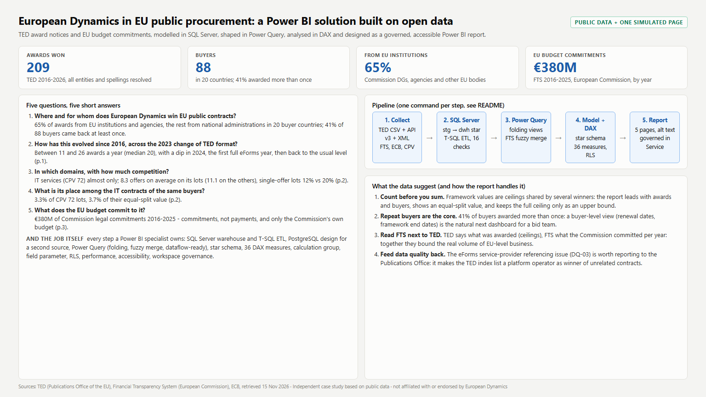
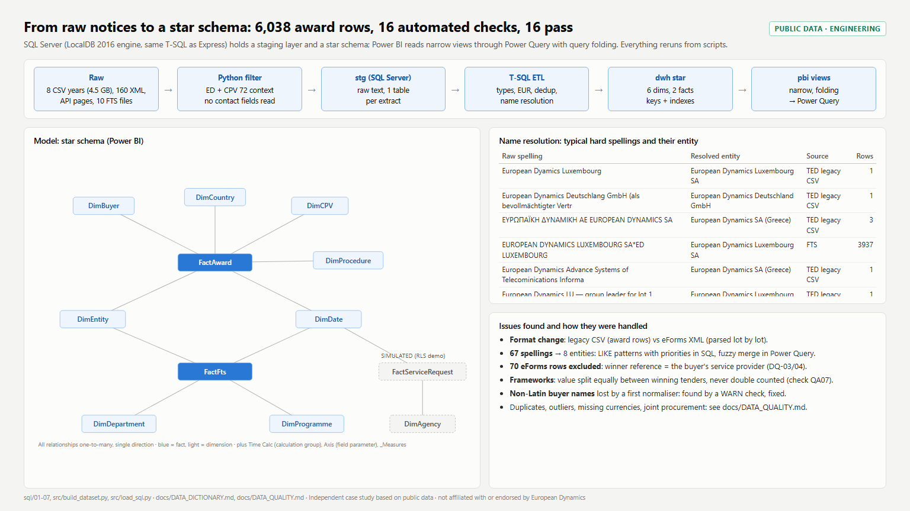

# European Dynamics in EU public procurement: a Power BI solution built on open data

**TED award notices and EU budget commitments, modelled in SQL Server, shaped in Power Query, analysed in DAX and
designed as a governed, accessible Power BI report.**

* **PDF (8 pages):** [`docs/EuropeanDynamics_PowerBI_CaseStudy.pdf`](docs/EuropeanDynamics_PowerBI_CaseStudy.pdf)
* **Power BI project (TMDL + PBIR):** [`powerbi/EuroDynProcurement.pbip`](powerbi/EuroDynProcurement.pbip) - 5 report pages, hidden documentation page, tooltip page

The subject is the company; the form is the job: the full chain of a Power BI specialist - SQL Server warehouse and
T-SQL ETL, a second source designed for PostgreSQL, Power Query (folding, fuzzy merge, dataflow-ready), star schema,
36 DAX measures, calculation group, field parameter, row-level security, performance, accessibility and workspace
governance. Data are public (**PUBLIC DATA**), except one clearly separated e-Government service-desk page
(**SIMULATED**, fictional ministry) used to demonstrate SLA measures and RLS.



## Key results

1. **209 awards from 88 buyers since 2016** (TED, 2016 to 13 Nov 2026, all entities and 68 spellings resolved);
   65% come from EU institutions and agencies, the rest from national administrations; 41% of buyers awarded more
   than once.
2. **IT services almost only.** European Dynamics holds 3.3% of the CPV 72 lots of its own buyers and of EU
   institutions. Its lots drew 8.3 offers on average (11.1 for the other lots); 12% were single-offer (20% for the
   others). A gradient-boosting model (ROC AUC 0.89, 5-fold CV) shows that the **procedure type** explains most
   single-offer lots - a single offer is not an anomaly in itself.
3. **EUR 380 million of European Commission legal commitments** to European Dynamics entities in 2016-2025 (FTS),
   rising from EUR 55 million in 2016-2018 to EUR 173 million in 2023-2025; TAXUD, JRC and DIGIT account for 47%.
   Commitments, not payments, and only the Commission's own budget.
4. **Data quality is part of the result:** 16 automated checks (all pass), 70 eForms rows excluded because the winner
   reference points to the buyer's *service provider* (DQ-03/04), framework ceilings split between winners so that no
   lot value is counted twice, and covering indexes that cut report-query reads on SQL Server from 372 to 6.

| Report page | What it shows |
|---|---|
| 1 Overview | KPIs, awards per year with 3-year moving average, buyer map + country bars, calculation-group matrix |
| 2 Buyers & countries | segment slicer, field parameter (switchable axis), repeat buyers, decomposition tree (AI visual), buyer tooltip |
| 3 Domains & competition | CPV domains, offers received, single-offer share by procedure, share of CPV 72, ML model |
| 4 EU budget (FTS) | commitments vs estimated consumed by year, by department, programme family, contract type |
| 5 e-Gov service desk (SIMULATED) | SLA %, P90 resolution, backlog, anomaly detection on daily requests, **dynamic RLS by agency** |

## Model

Star schema: `FactAward` (notice x lot x winning tender) and `FactFts` (FTS commitments) share `DimDate` and
`DimEntity`; `DimBuyer`, `DimCountry`, `DimCPV` (Division > Group > Class > Code hierarchy), `DimProcedure`,
`DimDepartment`, `DimProgramme`; SIMULATED `FactServiceRequest` + `DimAgency` + `SecUserAgency` (RLS mapping).
All relationships one-to-many, single direction.



## Repository

| Folder | Content |
|---|---|
| `sql/` | `01` database and schemas · `02` reference data (entity aliases, code lists) · `03` star schema, keys, indexes · `04` T-SQL ETL procedure · `05` Power BI views · `06` data-quality checks · `07` analysis queries (CTE, window functions) · `postgres/01_fts.sql` |
| `powerquery/` | one M file per table (single source of truth, inlined into the model by `src/build_tmdl.py`) |
| `powerbi/` | `.pbip` project: semantic model (TMDL) and report (PBIR), theme |
| `src/` | collection, filtering, warehouse load, simulation, ML, performance test, model / report / docs / PDF generators |
| `notebooks/analysis.ipynb` | collection summary, data checks, SQL answers, single-offer model |
| `docs/` | PDF, [data dictionary](docs/DATA_DICTIONARY.md), [measures](docs/MEASURES.md), [data quality](docs/DATA_QUALITY.md), [dataflows](docs/DATAFLOWS.md), [Service deployment](docs/SERVICE_DEPLOYMENT.md), [performance](docs/PERFORMANCE.md), [accessibility](docs/ACCESSIBILITY.md) |
| `data/processed/` | filtered extracts (staging CSV), QA results, ML outputs - the raw downloads are not versioned |

## How to rerun

Windows, Python 3.13, SQL Server **LocalDB** or **Express** (ODBC driver: Native Client 11 or ODBC Driver 17/18),
Microsoft Edge (PDF), Power BI Desktop.

```bash
python -m venv .venv && .venv\Scripts\activate && pip install -r requirements.txt
```

```bash
python src/download_ted.py
```

```bash
python src/download_fts.py
```

```bash
python src/build_dataset.py
```

```bash
python src/run_all.py
```

`run_all.py` runs the SQL scripts `sql/01` to `sql/06` in order through `src/load_sql.py` (connection in `.env`, see
`.env.example`; default `(localdb)\MSSQLLocalDB`, database `EuroDynDW`), then the model, report, docs, notebook and PDF.
The three download / filter steps can be skipped: the filtered extracts are in `data/processed/`. Finally open
`powerbi/EuroDynProcurement.pbip` in Power BI Desktop and refresh (parameters `ServerName`, `DatabaseName`, `DataFolder`).

## Sources and licences

* **TED** - Tenders Electronic Daily, Publications Office of the EU: *Contract award notices* CSV subset 2016-2023
  (data.europa.eu, dataset `ted-csv`), Search API v3 and notice XML for eForms notices to 13 Nov 2026.
* **FTS** - Financial Transparency System, European Commission, yearly datasets 2016-2025.
* **ECB** euro reference rates (annual averages), **CPV 2008** code list (TED).
* **eurodyn.com** - company facts quoted *as stated by European Dynamics* (read 15 Nov 2026).

EU data: (c) European Union, reuse authorised with attribution (Commission Decision 2011/833/EU). Collection used
official endpoints only, one request per second, with caching; retrieved on 15 November 2026.

## Limits

* Framework award values are **ceilings**, not spending; the equal split between winning tenders is a convention.
* TED covers notices published at EU level; below-threshold national contracts are absent.
* Market context = CPV 72 awards of the same buyers and of EU institutions; the eForms context (2023+) is at notice
  level. The number of offers is missing on part of the notices. Buyer country = where the buyer sits.
* FTS = European Commission commitments only (not payments, not other institutions' budgets). 2026 is partial.
* **Honest status of the tooling:** SQL Server runs on **LocalDB** (same engine and T-SQL as Express). **PostgreSQL**:
  script and Power Query connection provided, but the report reads the same FTS extract **as CSV** (no PostgreSQL
  server was installed). The Power BI project is generated as TMDL + PBIR (report files validated against Microsoft's
  JSON schemas); **Power BI Service** deployment is documented, not run on a tenant.
* Neutral reading: a single offer, repeat buyers or large frameworks are not anomalies in themselves. No employee of
  European Dynamics is named; contact fields in the notices are never read.

## Methods

T-SQL (set-based ETL, CTE, window functions, covering indexes), Power Query M (query folding, fuzzy merge,
dataflow-ready parameters), DAX (CALCULATE and filter context, time intelligence, calculation group, field parameter,
dynamic RLS with USERPRINCIPALNAME), scikit-learn (gradient boosting, logistic regression, permutation importance),
Python for collection and file generation, headless Edge for the PDF.

AI-assisted workflow: I used Claude, mainly to write scripts faster. I drove the project: I defined the questions, chose and validated the data sources, made the analytical decisions and checked every result.

---
Independent case study based on public data · not affiliated with or endorsed by European Dynamics
